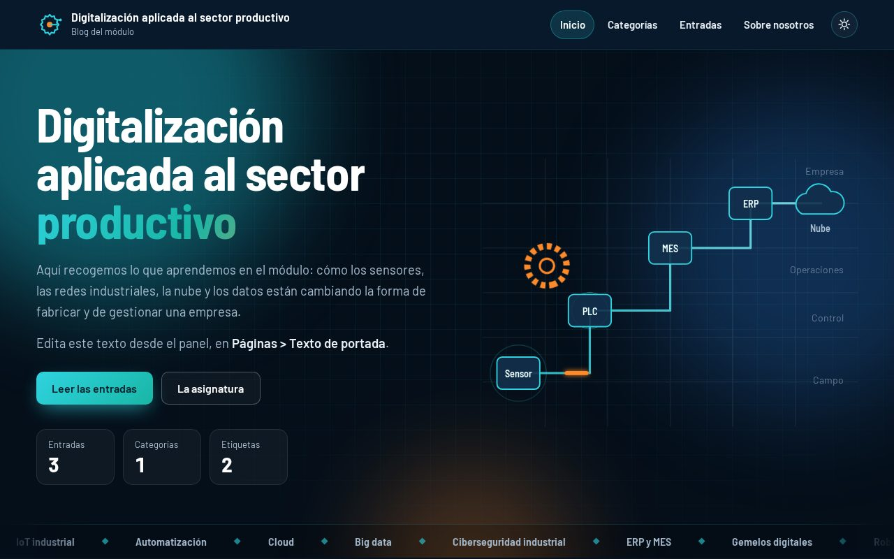
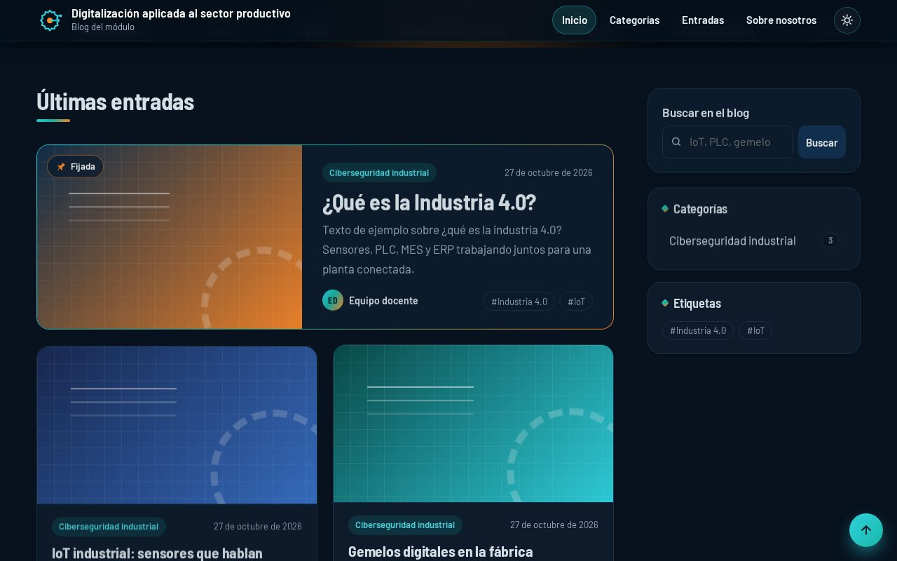
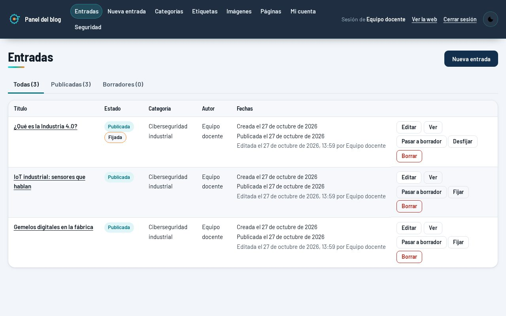
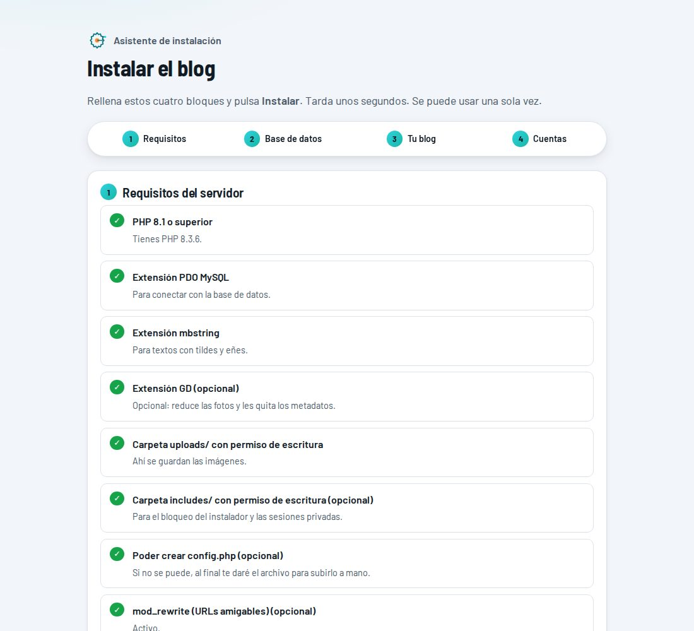

# Blog de Digitalización aplicada al sector productivo

Blog en **PHP 8 + MySQL**, sin frameworks ni dependencias, pensado para la asignatura *Digitalización aplicada al sector productivo* (ASIR). Se despliega en cualquier hosting con PHP, **incluso gratuito como InfinityFree**, subiendo los archivos y siguiendo un asistente.

Todo el contenido se gestiona desde un panel de administración: entradas, categorías, etiquetas, imágenes y páginas. El código no lleva ningún texto del blog.



| Entradas | Panel | Asistente de instalación |
|---|---|---|
|  |  |  |

## Índice

1. [Características](#características)
2. [Despliegue rápido (5 minutos)](#despliegue-rápido-5-minutos)
3. [Guía completa de despliegue](docs/DESPLIEGUE.md)
4. [Actualizar a una versión nueva](docs/DESPLIEGUE.md#actualizar-a-una-versión-nueva)
5. [Seguridad](SECURITY.md)
6. [Estructura del proyecto](#estructura-del-proyecto)
7. [Licencia](#licencia)

## Características

**Web pública**
- Portada con cabecera animada y entradas en tarjetas.
- Entradas fijadas.
- Páginas de categorías, etiquetas y todas las entradas.
- Buscador, paginación y URLs amigables.
- Modo claro y oscuro.
- Diseño adaptable y accesible (respeta «reducir movimiento»).

**Panel `/admin`**
- Editor Markdown con vista previa.
- Borradores y publicación.
- Imagen destacada.
- Subida de imágenes (JPG, PNG y WebP, que se re-codifican y pierden los metadatos).
- Páginas editables: «Sobre nosotros» y el texto de la portada.

**Instalación**
- Asistente que pide los datos de MySQL, el nombre del blog y las cuentas.
- Escribe `config.php` por sí solo.
- Después se bloquea y se borra.

**Seguridad**
- Contraseñas con bcrypt.
- Verificación en dos pasos (TOTP) opcional, con códigos de recuperación.
- CSRF, comprobación de origen y límite de intentos.
- Sesiones atadas al navegador y CSP estricta.
- Página de diagnóstico del servidor (incluye la comprobación de PHP2Shell).

**Requisitos mínimos**
- Sin Composer, Node ni línea de comandos en el servidor. No hace AJAX hacia sus propios scripts, así que funciona aunque el hosting tenga un antibot por JavaScript.

## Despliegue rápido (5 minutos)

> Necesitas un hosting con **PHP 8.1+** (recomendado 8.2.35 o superior) y **una base de datos MySQL/MariaDB vacía**.

1. **Descarga** el proyecto: botón verde **Code → Download ZIP** (o la última versión en *Releases*).
2. **Crea la base de datos** en el panel de tu hosting y apunta el host, el nombre, el usuario y la contraseña.
3. **Sube los archivos** a la carpeta pública del hosting (`htdocs`, `public_html`…). Sube el *contenido* de la carpeta del proyecto, incluido `.htaccess`.
4. **Abre tu dominio** en el navegador. Aparece solo el **asistente de instalación**:

   | Paso | Qué te pide |
   |---|---|
   | 1. Requisitos | Nada, solo comprueba el servidor (en verde, lo que está bien). |
   | 2. Base de datos | Host, puerto, nombre, usuario y contraseña de MySQL. Prueba la conexión. |
   | 3. Tu blog | Nombre, subtítulo, texto del pie, zona horaria y opciones. |
   | 4. Cuentas | Una o dos cuentas de administrador (usuario, nombre de autor y contraseña). |

5. Pulsa **Instalar el blog**. El asistente crea las tablas, guarda `config.php`, se bloquea y se borra.
6. Entra en `https://tu-dominio/admin/`. Después, en *Mi cuenta*, activa la **verificación en dos pasos**, y en *Páginas* escribe los textos.

Para hostings concretos (InfinityFree, cPanel, XAMPP en tu PC), SSL o problemas frecuentes, consulta la **[guía completa](docs/DESPLIEGUE.md)**.

## Estructura del proyecto

```
├── index.php, post.php, entradas.php, categorias.php, sobre.php   Web pública
├── install.php            Asistente de instalación (se borra solo al terminar)
├── config.example.php     Plantilla de config.php para instalarlo a mano
├── admin/                 Panel: entradas, editor, categorías, etiquetas,
│                          imágenes, páginas, mi cuenta, seguridad, 2FA
├── includes/              Lógica (bloqueada desde la web por .htaccess)
│   ├── defaults.php       Valores por defecto de la configuración
│   ├── security.php       2FA, migraciones automáticas, diagnóstico
│   └── …
├── assets/                CSS, JS (sin librerías externas salvo un QR local) y fuentes
├── uploads/               Imágenes subidas (solo se sirven imágenes)
├── sql/                   Esquema y migraciones para phpMyAdmin
└── docs/                  Documentación y capturas
```

`config.php` (con la contraseña de la base de datos), las imágenes subidas y las sesiones **no se suben al repositorio**: están en `.gitignore`.

## Licencia

[MIT](LICENSE). Puedes usarlo, copiarlo y modificarlo libremente, también para tu propia clase.

Incluye la fuente [Barlow](https://github.com/jpt/barlow) (licencia SIL OFL 1.1) y [qrcode-generator](https://github.com/kazuhikoarase/qrcode-generator) (MIT).
